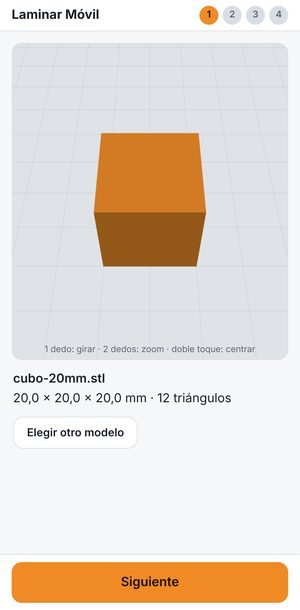
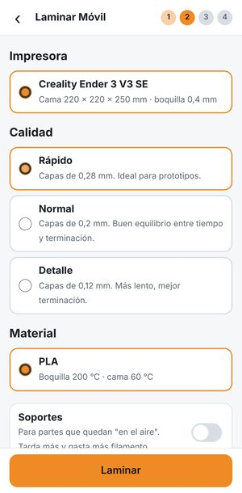
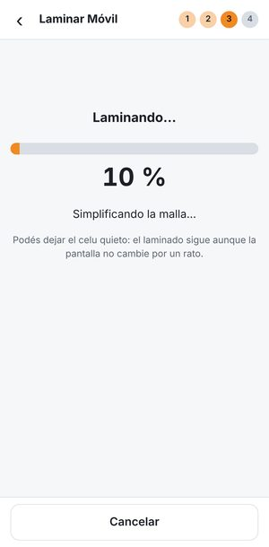
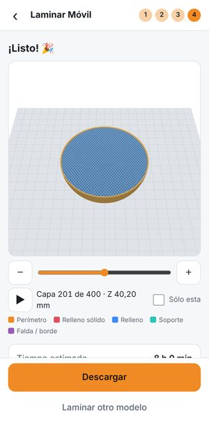
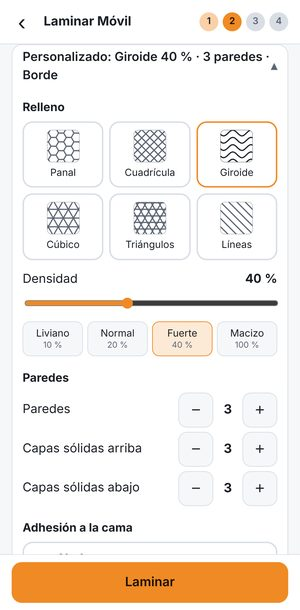
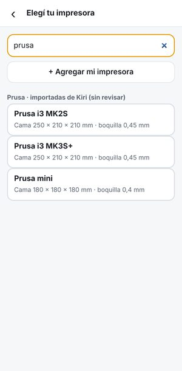

# Laminar Móvil

Laminador **STL → G-code 100 % en el navegador**, pensado para usar con el celu y con una mano.
Sin servidor, sin cuentas y sin costos: el archivo nunca sale del teléfono.
Funciona sin conexión y se puede instalar como app (PWA).

Mapa del código (empezá por acá si algo falla): [`docs/MAPA.md`](docs/MAPA.md).

El motor de laminado es [Kiri:Moto](https://github.com/GridSpace/grid-apps) (licencia MIT).

<p>






</p>

## Qué hace

1. **Subir STL, OBJ o 3MF**, o generar una **litofanía o relieve desde una foto** (o abrir uno reciente). Visor 3D con gestos: 1 dedo gira, 2 dedos zoom/mover, doble toque centra.
   **Acomodar el modelo en la cama**: escala (%), rotar de a 90° en X/Y/Z, **apoyar cara** (tocás una
   cara y queda sobre la cama) y "Achicar para que entre" si es más grande que la cama.
2. **Elegir impresora, calidad y material** (Rápido 0,28 · Normal 0,2 · Detalle 0,12 mm; PLA) y si lleva soportes.
   En **Personalizar**: patrón de relleno (panal, cuadrícula, giroide, cúbico, triángulos, líneas),
   densidad, paredes, capas sólidas y adhesión (nada, falda, borde o balsa).
   En **Avanzado**: modo jarrón (espiral), altura de capa variable, costura, retracción, z-hop,
   coasting, wipe, compensación de agujeros y contorno, velocidad %, temperaturas y ventilador.
   **Materiales**: PLA, PLA+, PETG, TPU, ABS y ASA, con avisos y **costo estimado** según el
   precio del rollo.
3. **Laminar** con barra de progreso, en un Web Worker (la pantalla no se congela). Se puede cancelar.
4. **Vista previa capa por capa** (deslizador, ±, reproducir, "sólo esta capa", colores por tipo de
   línea), **pausas para cambiar de filamento** en las capas que elijas (piezas de varios colores,
   con la vista previa pintada del color de cada filamento)
   y **descargar o compartir** el G-code (Web Share API en celus que lo soportan).
   Las Bambu Lab (A1, A1 mini, P1S y X1C) bajan un **`.gcode.3mf`** (ZIP con el G-code y los metadatos que espera Bambu) en vez de `.gcode`. Los perfiles no están validados con la impresora.

Además:

- Si el STL tiene demasiados triángulos para la RAM del equipo, se **simplifica antes de laminar** y se avisa.
- Recuerda la última configuración y los últimos 6 modelos (IndexedDB, en el celu).
- Avisa si el modelo no entra en la cama y limita las temperaturas a los máximos de la impresora.
- **Varias piezas y copias en la cama**: agregás piezas (archivo o cubo de ejemplo), les ponés copias y la app
  las acomoda sola (ADR 0003). Las copias que no entran se marcan en rojo y "Siguiente" queda deshabilitado.

Impresoras:

- **Perfiles revisados a mano** (con pruebas automáticas): Creality Ender 3 V3 SE, Ender 3 V2, Ender 3 V3 KE
  y K1; Elegoo Neptune 4; Anycubic Kobra 2 y Kobra 3; Prusa MK4; Sovol SV06; Bambu Lab A1, A1 mini, P1S y X1C (salen como
  `.gcode.3mf`, sin validar con la impresora).
- **48 impresoras importadas de Kiri:Moto** (Creality, Anycubic, Prusa, Flashforge, Wanhao…),
  marcadas "sin revisar".
- **Mi impresora**: cada usuario puede cargar la suya (medidas, boquilla, Marlin/Klipper, G-code)
  o copiar una existente para ajustarla. Se guarda en el celu.

## Desarrollo

Requiere Node 20 o más nuevo.

```bash
npm install
npm run dev          # servidor local en http://localhost:5173
npm run build        # build estático en dist/
npm run preview      # sirve dist/ (para probar la PWA y el modo offline)
```

Pruebas automáticas (usan Chromium; en otra máquina definí `CHROMIUM_PATH`):

```bash
npm run build
npm run test:motor   # lamina mallas de prueba y valida el G-code (perfil, calidades, soportes, malla de 1,2 M triángulos)
npm run test:transformar  # matrices de escala/rotación (Node, sin navegador)
npm run test:app     # recorre la app emulando un Pixel 7: 4 pasos, cancelar, atrás, descarga, recientes, offline
```

Calidad de código y contratos de los módulos de la interfaz (sin navegador):

```bash
npm run lint             # ESLint (recomendado + límites de tamaño como aviso)
npm run format           # Prettier: aplica el formato (format:check sólo verifica)
npm run test:contratos   # exports, aridad, que importar no toque el DOM, aristas permitidas y ciclos (ADR 0001)
```

La CI de GitHub Actions (`.github/workflows/ci.yml`) corre build, lint, format:check y todas las suites en cada PR y en cada push a `main`.

Para probar en el celu en la misma red Wi-Fi: `npm run build && npx vite preview --host` y abrí la
dirección que muestra. Ojo: el service worker (offline/instalación) sólo funciona con **HTTPS** o en
`localhost`, así que para probar eso conviene deployar (es gratis, ver abajo).

`prueba-motor.html` es una página de diagnóstico que lamina mallas sin pasar por la interfaz.

## Deploy gratis

El build es una carpeta estática (`dist/`) con rutas relativas, así que funciona en la raíz de un
dominio o en un subdirectorio. No hace falta configurar nada especial en el hosting.

### Opción A: Vercel (la que usa este repo)

1. En [vercel.com](https://vercel.com): **Add New → Project** e importá el repo de GitHub.
2. Vercel detecta Vite solo: build `npm run build`, carpeta `dist`. No hay que cambiar nada.
3. **Deploy.** Cada push a `main` publica en producción (`https://<proyecto>.vercel.app`) y cada
   PR tiene su propia URL de prueba, ideal para probar en el celu antes de mergear.

El plan gratis (Hobby) alcanza, pero es para uso personal no comercial. Las URLs de prueba de
los PR pueden pedir login de Vercel (Deployment Protection); la de producción es pública.

### Opción B: Cloudflare Pages (alternativa)

1. En el panel de Cloudflare: **Workers & Pages → Create → Pages → Connect to Git** y elegí el repo.
2. Configuración del build:
   - Framework preset: **None** (o Vite)
   - Build command: `npm run build`
   - Build output directory: `dist`
   - La versión de Node la toma del archivo `.node-version` (22).
3. Guardá. Cada push a la rama elegida publica una versión nueva en `https://<proyecto>.pages.dev`.

Sin conectar Git también se puede subir a mano: `npm run build && npx wrangler pages deploy dist`.

También funciona en GitHub Pages u otro hosting estático: alcanza con publicar la carpeta `dist/`.

### Actualizaciones

Cuando publicás una versión nueva, la app instalada la baja sola en segundo plano y muestra
"Hay una versión nueva de la app" con un botón **Actualizar** (no se actualiza sola para no cortar
un laminado a la mitad).

## Agregar una impresora

Para uso personal alcanza con **"Agregar mi impresora"** dentro de la app. Para sumarla a la app
para todos:

1. Copiá `src/perfiles/impresoras/creality-ender-3-v3-se.json` con otro nombre en la misma carpeta.
2. Cambiá `id` (único, sin espacios) y `nombre`.
3. Ajustá `limites` (temperaturas máximas), `dispositivo` (tamaño de cama, boquilla, filamento,
   G-code de inicio/fin) y los valores de `proceso` y `calidades`.
4. `npm run build`. La impresora aparece sola en la lista; no hay que tocar código.

Las claves son las de Kiri:Moto y están explicadas en español en
[`src/perfiles/LEEME.md`](src/perfiles/LEEME.md). Importante: definí `gcodeFan`, si no Kiri no
prende nunca el ventilador de capa. Los materiales se agregan en `src/perfiles/materiales.json`.

Las 50 importadas se regeneran con `npm run importar:impresoras` (usa el clon de grid-apps de
`npm run vendor:kiri`). El importador saltea las que no sirven con G-code plano (Makerbot; las
Bambu Lab tienen perfil revisado propio) y avisa en la app cuando el G-code de inicio no usa la temperatura elegida.

## Cómo está armado

```
index.html, src/main.js     Punto de entrada: inicializa los módulos de la interfaz (JS sin frameworks)
src/ui/                     Interfaz: un módulo por paso (paso1-modelo, paso2-config, paso3-laminar,
                            paso4-resultado) y las piezas compartidas (estado, navegacion, impresoras...).
                            Ver docs/MAPA.md y docs/decisiones/0001-dividir-main.md
src/ui/visor.js             Visor 3D (three.js + OrbitControls)
src/motor/motor.js          API del motor para la interfaz (un worker por tarea)
src/motor/laminador.worker.js  Worker de laminado: lee STL, simplifica, llama a Kiri
src/motor/vista.worker.js   Worker liviano para la vista previa
src/motor/decimar.js        Simplificación de malla (agrupamiento en grilla)
src/motor/minions-locales.js  Soportes de Kiri sin su pool de sub-workers
src/motor/recorridos.worker.js  Lee el G-code para la vista previa capa por capa (y dónde pausar)
src/motor/pausas.js         Inserta las pausas de cambio de filamento al descargar
src/motor/transformar.js    Matrices 3×3: escala, rotaciones y "apoyar cara" (las usa el laminador)
src/perfiles/               Impresoras, materiales y opciones en JSON; generico.js arma
                            calidades y perfiles a partir de pocos datos
scripts/importar-impresoras-kiri.mjs  Trae los perfiles de impresoras de Kiri:Moto
scripts/app/               Pruebas de la app por área (las orquesta scripts/probar-app.mjs)
scripts/lib/               Helpers compartidos de las pruebas (servidor, Chromium, contadores)
src/almacen.js              IndexedDB: preferencias y modelos recientes
src/sw.js                   Service worker (offline); la lista de archivos la completa vite.config.js
vendor/kiri/                Motor Kiri:Moto (sólo los archivos que usa el worker)
```

Decisiones para celus de gama baja:

- Todo el laminado corre en **un solo** Web Worker (Kiri normalmente abre 4 o más sub-workers;
  así gasta mucha menos RAM, a costa de tardar más en una PC).
- Cada laminado abre un worker nuevo y lo cierra al terminar, liberando toda la memoria.
- Máximo de triángulos según `navigator.deviceMemory`: 100 mil (≤ 2 GB), 200 mil (4 GB),
  500 mil (≥ 8 GB) y 250 mil si el navegador no informa la memoria (iPhone, Firefox). Se cambia en `src/config.js`.
- Mientras lamina se pide que la pantalla no se apague (Wake Lock).
- Vista previa: los tramos alineados se unen y las coordenadas se guardan en enteros de 16 bits
  (18 bytes por tramo). Tope de tramos según la memoria (1 a 6 millones, `src/config.js`); si el
  G-code tiene más, se muestran las primeras capas y se avisa. El visor sólo redibuja cuando algo
  cambia (gesto o capa), así no gasta batería con millones de líneas quietas.

### Actualizar Kiri:Moto

```bash
npm run vendor:kiri                      # clona GridSpace/grid-apps y copia lo necesario
npm run vendor:kiri -- /ruta/a/grid-apps # o usando un clon que ya tengas
npm run build && npm run test:motor
```

El script copia sólo los ~114 archivos que importa el worker de Kiri, conserva su licencia y
encabezados, y reemplaza por "shims" las librerías que no hacen falta para FDM (QuickJS, manifold,
RasterPath). Detalle en `vendor/kiri/ORIGEN.md`.

También aplica dos parches a bugs de Kiri 4.7.0 que afectaban el G-code (marcados con
`PARCHE laminar-movil`): el ventilador de capa quedaba apagado casi toda la impresión
(la macro `M106 S{fan_speed}` salía con el valor viejo) y la primera capa se trataba como
"capa puente" para el ventilador. Si al actualizar Kiri el parche ya no aplica, el script avisa.

## Lo que NO pude validar

Todo lo de arriba está probado de forma automática en Chromium de escritorio emulando un celu.
Esto queda pendiente de validar a mano:

### Perfil de la Ender 3 V3 SE (contrastar con Creality Print / OrcaSlicer oficiales)

- [ ] **Imprimir de verdad** un G-code generado (empezar por el cubo de ejemplo en calidad Normal).
- [ ] Volumen 220 × 220 × 250 mm y origen en la esquina frontal izquierda.
- [ ] **Start G-code**: sólo `G28`, sin `G29`. Confirmar si el firmware aplica la malla guardada
      después de `G28`; si no, agregar `M420 S1` después del `G28`.
- [ ] Línea de purga en X = 2 mm (el perfil oficial de Creality purga en X = −2,1, fuera de la cama;
      la dejé adentro por seguridad).
- [ ] End G-code: retracción de 4 mm, subida de 10 mm y "presentar" la pieza en Y = 220.
- [ ] Retracción 0,8 mm a 40 mm/s y sin z-hop.
- [ ] Velocidades: Rápido 120/80, Normal 100/60, Detalle 70/40 mm/s (relleno/perímetro exterior),
      viajes a 150 mm/s, primera capa a 30 mm/s. Kiri no manda aceleraciones (`M204`): usa las del firmware.
- [ ] Caudal máximo 15 mm³/s (frena la velocidad si se supera).
- [ ] Multiplicador de extrusión de Kiri (1,25 por defecto, compensa su fórmula): revisar con un cubo
      que las paredes salgan del ancho correcto.
- [ ] PLA a 200 °C / cama 60 °C, ventilador al 100 % desde la capa 2, precalentado de boquilla a 150 °C.
- [ ] Paredes, capas sólidas y relleno de cada calidad.
- [ ] La estimación de tiempo de Kiri no tiene en cuenta aceleraciones: puede quedar corta.

### En un celu real

- [ ] Rendimiento y memoria en un celu de gama baja (2–3 GB). Ajustar los máximos de triángulos si se cuelga.
- [ ] Selector de archivos: en algunos Android los `.stl` aparecen en gris con el filtro de tipos.
- [ ] Compartir el G-code (Web Share con archivos) en Android e iOS: que lo acepten como
      `text/plain` y que se conserve la extensión `.gcode`.
- [ ] Descarga en iOS Safari (a veces abre una vista previa en vez de guardar).
- [ ] Gestos táctiles reales (pellizcar para zoom, girar con un dedo).
- [ ] Fluidez de la vista previa capa por capa con un G-code grande (1–2 millones de tramos) en la
      GPU de un celu. Acá sólo pude probar con render por software.
- [ ] Formulario "Mi impresora" con el teclado del celu (campos numéricos, G-code largo).
- [ ] **Pausa de filamento en una impresora real**: que la Ender 3 V3 SE acepte `M600` (con su
      firmware de fábrica), estacione el cabezal y retome bien. En Klipper se usa `PAUSE`
      (necesita `[pause_resume]` en `printer.cfg`). La posición de la pausa en el G-code sí está
      probada: queda entre la última línea de la capa anterior y la subida de Z.
- [ ] Instalación como app (Android: "Instalar app"; iOS: Compartir → "Agregar a inicio") y uso sin conexión.
- [ ] Workers con módulos ES: requiere iOS 15 o más nuevo; Wake Lock: iOS 16.4 o más nuevo.
- [ ] iOS Safari puede borrar los datos guardados (recientes) si la app no está instalada y no se usa por un tiempo.
- [ ] Flujo de "Hay una versión nueva" después de publicar una actualización.

### Varias piezas y perfiles revisados nuevos

- [ ] Imprimir varias copias en una cama real: que el acomodo y la separación de 10 mm se vean igual en el G-code y en la impresora.
- [ ] Los perfiles revisados nuevos, sobre todo el Kobra 3 (el aviso del perfil dice que no se pudo confirmar el firmware de fábrica).
- [ ] `M600` en la Ender 3 V2 (el firmware de fábrica puede no traerlo).
- [ ] Macros `START_PRINT` en la K1 y la Ender 3 V3 KE: que el firmware real las tenga con esos parámetros.
- [ ] `PAUSE` y `BED_MESH_CALIBRATE` en el Neptune 4 (el perfil los marca como sin confirmar en el equipo real).
- [ ] La memoria con muchas copias en un celu de gama baja.

### Impresoras importadas de Kiri

- [ ] Las 50 laminan el cubo de prueba sin errores, centrado y con ventilador (prueba automática),
      pero **ninguna está probada en una impresora real**. Varios perfiles de Kiri son viejos o
      tienen G-code de inicio dudoso (la app lo avisa cuando no usa `{temp}`/`{bed_temp}`).
- [ ] En Kiri, a igual porcentaje, el giroide usa bastante menos material que el panal (cubo de
      20 mm al 20 %: 1,18 m contra 2,08 m). Revisar si conviene compensar la densidad por patrón.

### Bambu Lab: `.gcode.3mf` (ADR 0005)

- [ ] Abrir el `.gcode.3mf` en **Bambu Studio** sin errores, con tiempo y gramos a la vista (y qué hace con el `3dmodel.model` sin malla).
- [ ] Abrirlo en **Bambu Handy** y que muestre el resumen.
- [ ] **Imprimir un cubo por SD y por LAN** en A1 y P1S, y que la impresora no rechace el archivo por el MD5.
- [ ] La pausa **`M400 U1`**: que pause, muestre el aviso en la pantalla y retome. Qué pasa con la temperatura durante la pausa.
- [ ] **Compartir en Android (Chrome) e iOS (Safari)**: qué MIME acepta `canShare` para el `.gcode.3mf` (`application/octet-stream`, `application/zip`, `model/3mf`).
- [ ] Las miniaturas: que la pantalla de la impresora y Bambu Studio las muestren.
- [ ] Volver con "Adelante" al paso 4 después de cambiar el material: que el archivo que se descarga o comparte tenga el G-code del material nuevo.
- [ ] Filamento: el código de bandeja y el color de `slice_info.config` son fijos (`GFL99`, `#FFFFFF`) para todos los materiales; hay que mapearlos antes de imprimir PETG u otro material.

### Otros

- [ ] Probar la URL de Vercel en un celu real (instalar la app y usarla sin conexión).
- [ ] Licencia: el repo de Kiri:Moto es MIT (`license.md`), pero los archivos fuente dicen
      "Copyright Stewart Allen -- All Rights Reserved" en el encabezado. Lo interpreto como aviso de
      copyright compatible con la MIT (el readme dice "free for use without restriction"); para
      tener certeza, se le puede consultar al autor.

## Licencia

MIT (ver `LICENSE`). El motor en `vendor/kiri/` es Kiri:Moto, © Stewart Allen, MIT (`vendor/kiri/license.md`).
